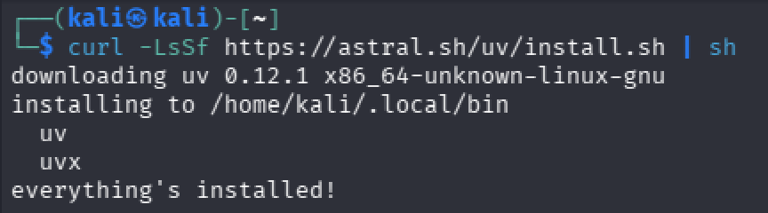
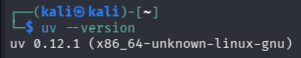
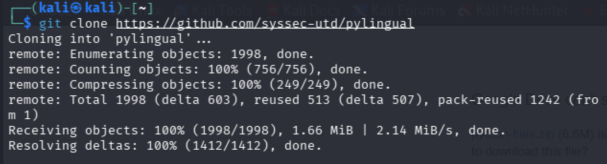
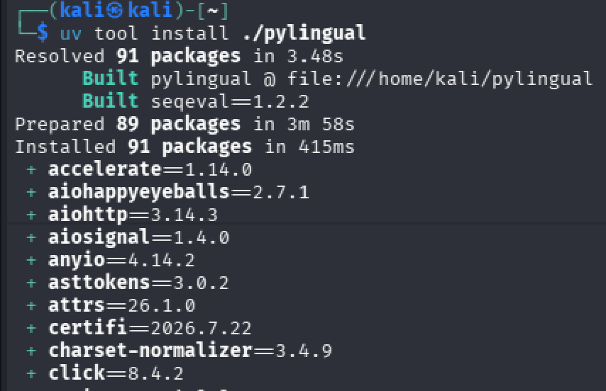
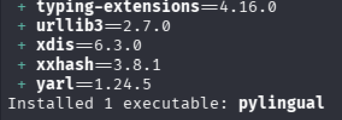
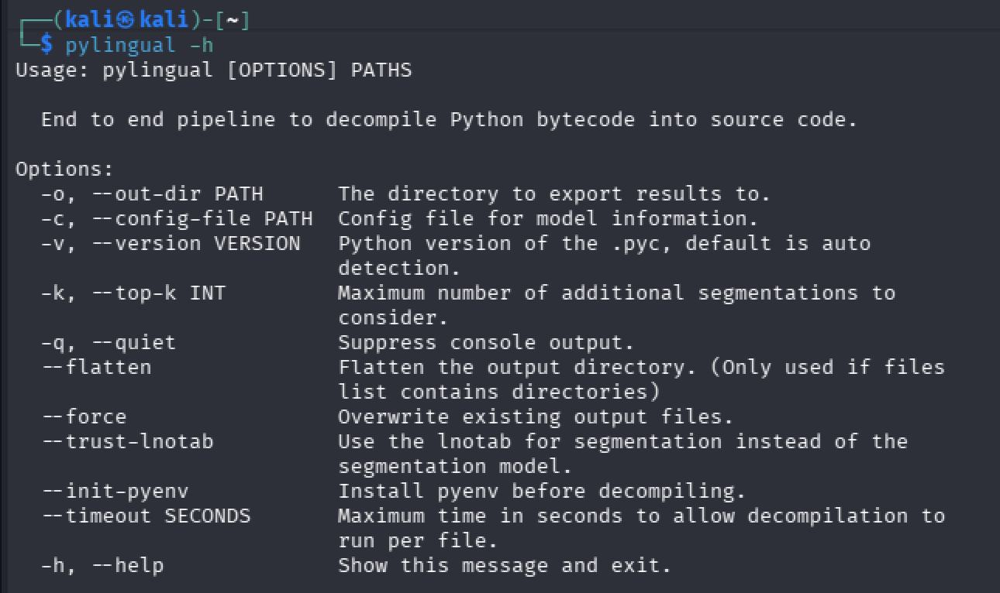

:orphan:
(pylingual)=

# Pylingual Python Decompiler

This article outlines the steps to set up the Pylingual python decompiler on a Kali VM to decompile python executables.

## Tools/Skills Required

- Kali Virtual Machine (You can use the prebuilt Kali images available)
- Ability to use the command-line terminal in Kali

## Steps to install Pylingual Decompiler on Kali

The `uv` package manager handles the installation of Pylingual. Begin by downloading and installing the `uv` package manager using the following command:

`curl -LsSf https://astral.sh/uv/install.sh | sh`

Comfirm that `uv` is installed using the following command:

`uv --version`

Then, retrieve the files for Pylingual from the official GitHub repository using the `git clone` command as shown below:

`git clone https://github.com/syssec-utd/pylingual`

Then, install Pylingual using the following command:

`uv tool install ./pylingual`

Once the installation is complete, the last line of output will indicate that Pylingual is installed successfully:

You can view Pylingual's the help menu using the `-h` switch:

Pylingual can now be used to decompile Python bytecode files.